# Về bản này

Bản trong Tàng Kinh Các chép từ tài liệu **“Dịch Cân Kinh”** của **Trần Đại Sỹ**, sưu tầm từ diễn đàn ttvnol.com. Phần chữ và hình minh họa giữ theo thứ tự của tài liệu gốc.

Mỗi thức có mục **“Nguyên bản”** là hình khắc gỗ cổ kèm bài thơ chữ Hán (bản *Dịch Cân Kinh thập nhị thế*). Tàng Kinh Các chép lại lời thơ trong hình và thêm phần phiên âm Hán Việt để đạo hữu dễ đọc.

> Dịch Cân Kinh là phép dưỡng sinh luyện gân cốt và hơi thở. Mục “Chủ trị” là ghi chép của tác giả, chỉ để tham khảo. Đạo hữu đang có bệnh, mang thai hoặc huyết áp cao nên hỏi ý kiến bác sĩ trước khi tập, và tập chậm, vừa sức.

# Thức thứ nhất · Cung thủ đương hung

## Cung thủ đương hung (Chắp tay ngang ngực)

### 1.- Động tác, tư thế

(1), Tý tiền bình cử (hai tay đưa ngang về trước), hai tay duỗi thẳng, hai bàn tay từ từ úp vào nhau, rồi đưa lên tới vị trí ngang ngực. (H1).

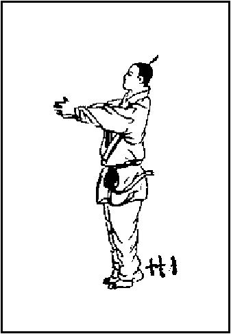

(2) Cung thủ hoàn bao (vòng tay khép lại): cùi chỏ từ từ co lại, cho đến khi hai cánh tay ép nhẹ vào thân. Hai bàn tay hướng thượng. Hai vai hạ xuống, xả khí trong lồng ngực. Xương sống buông lỏng. Khí trầm đơn điền. Lưỡi đưa sẽ chạm lên nóc vọng (palais). Giữ tư thức từ 10 phút đến một giờ, mắt như nhìn vào cõi hư vô, hoặc nhìn vào một vật thể thức xa. Cứ như vậy trong khoảng một thời gian nhất định, tâm trung cảm thấy thông sướng. Đó là cách thượng hư hạ thực. (H2).

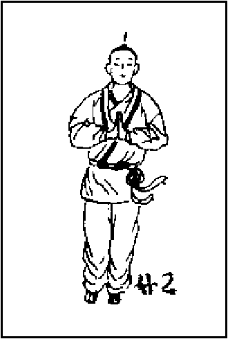

### 2.- Hiệu năng

Trừ ưu, giải phiền, Giao thông tâm thận.

### 3.- Chủ trị

Mất trí nhớ, tim đập thất thường. Dễ cáu giận, Nóng nảy, thiếu kiên nhẫn, Trong lòng lo sợ vô cớ, Thận chủ thủy, tâm chủ hỏa. Khi tâm thận bất giao, tức thủy không chế được hỏa, sẽ sinh mất ngủ, mất trí nhớ. Thức này có thể điều hòa tâm thận.

### 4.- Nguyên bản

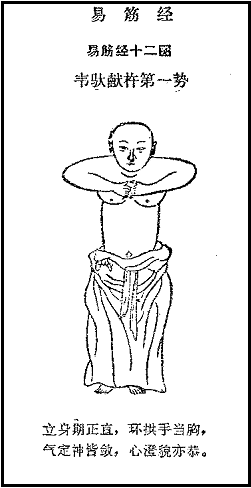

> **韦驮献杵第一势 · Vi Đà hiến xử đệ nhất thế**
> 立身期正直，环拱手当胸。
> *Lập thân kỳ chính trực, hoàn củng thủ đương hung.*
> 气定神皆敛，心澄貌亦恭。
> *Khí định thần giai liễm, tâm trừng mạo diệc cung.*

# Thức thứ nhì · Lưỡng kiên hoành đản

## Lưỡng kiên hoành đản (Hai vai đánh ngang)

### 1.- Động tác, tư thế

(1), Án chưởng hành khí (án tay, khí lưu thông), tiếp theo thức thứ nhất, hai bàn tay từ hợp rời nhau, úp xuống tới bụng, rồi đưa ra sau lưng (H3), đồng thời ý-khí theo bàn tay trầm đơn điền.

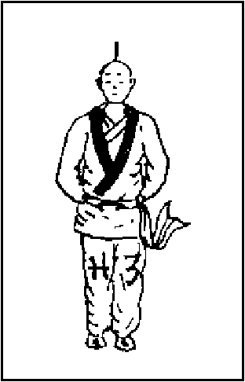

(2), Lưỡng tý hoành đản (hai tay ngang vai), hai tay từ từ đưa lên ngang vai, hai bàn tay hướng lên trời, mắt khép lại, dùng ý dẫn khí phân ra hai vai, bàn tay. Mắt từ từ mở ra. Lưỡi từ nóc vọng hạ xuống. Ý khí trên đầu, hông, đùi buông lỏng. Giữ tư thức càng lâu càng tốt. (H4)

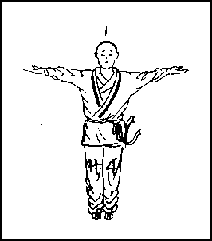

### 2.- Hiệu năng

Tráng yêu, kiên thận (làm cho lưng mạnh lên, giữ thận chắc chắn). Xả hung lý khí (làm cho lồng ngực mở ra, giữ khí điều hòa).

### 3.- Chủ trị

Trị chứng yếu thắt lưng, Bảo vệ thận, Trị chứng uất kết lồng ngực (thần kinh), Giữ toàn thể xương sống khi bị yếu (sau khi bệnh, tuổi già).

### 4.- Nguyên bản

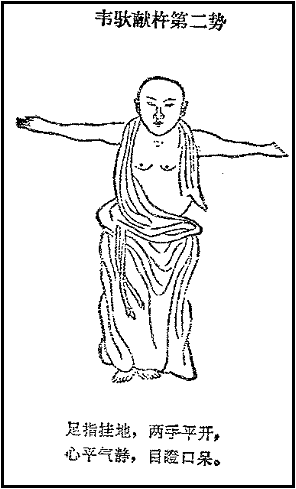

> **韦驮献杵第二势 · Vi Đà hiến xử đệ nhị thế**
> 足指挂地，两手平开，
> *Túc chỉ quải địa, lưỡng thủ bình khai,*
> 心平气静，目瞪口呆。
> *Tâm bình khí tĩnh, mục trừng khẩu ngai.*

# Thức thứ ba · Chưởng thác thiên môn

## Chưởng thác thiên môn (Hai tay mở lên trời)

### 1.- Động tác, tư thế

(1), Cử tý triển mục (nâng tay, phóng mắt): đưa tay, mở mắt, tiếp theo thức thứ 2, hai tay đưa thẳng lên trời, hai lòng bàn tay đối nhau. Đồng thời ngửa mặt nhìn trời (H5). Giữ tư thức dài, ngắn tùy hoàn cảnh. Như nhìn trời lâu mỏi mắt, thì hai mắt khép nhỏ lại dùng ý dẫn khí, tưởng như dẫn thiên khí vào não, theo xương sống (Đốc-mạch) tới ngang thắt lưng (huyệt Mệnh-môn) rồi tỏa nạp sang thận.

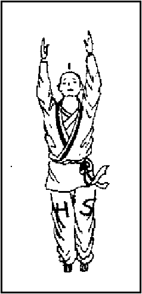

(2), Chưởng thác Thiên-môn (chưởng xuyên cửa trời): Tiếp theo, ngửa hai bàn tay lên trời, các ngón hai bàn tay đối nhau. Lưỡi từ từ nâng lên. Mặt nhìn trời, hướng vào chân trời xa xa (H6). Luyện càng lâu càng tốt. Khi mắt mỏi, thì từ khép nhỏ lại, tưởng tượng nhìn thấy đôi mắt trời.

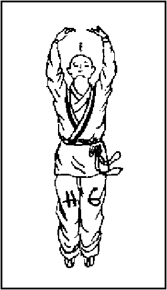

(3), Phủ chưởng quán khí (úp chưởng thu khí): tiếp theo thức trên, hai chưởng quay ngược hướng hạ. Hai cùi chỏ vòng như vòng cung. Đầu, cổ thẳng, mắt nhìn về trước, lưỡi hạ xuống (H7). Khi trở chưởng, ý niệm tưởng tượng thu được thiên khí, chuyển thẳng xuống ngang lưng; rồi lại thu thiên khí vào bàn tay nhập não (huyệt Bách-hội), qua hầu đưa tới hậu môn (huyệt Hội-âm). Những vị bị huyết áp cao, thì dẫn khí từ hậu môn xuống đùi, rồi tỏa xuống bàn chân, đưa xuống đất.

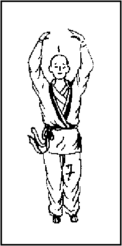

(4), Án chưởng tẩy tủy (án tay, tẩy tủy): tiếp theo thức trên, hai tay từ từ hạ xuống tới bụng, rồi buông thõng (H3). Ý niệm khí từ não (huyệt Bách-hội) theo não, dọc xương sống (Đốc-mạch) xuống xương cụt, đùi, bắp chân, thoát ra bàn chân.

### 2.- Hiệu năng

Ích tủy kiên thận.

### 3.- Chủ trị

Trị đau ngang lưng, Đau phía sau vai, Trị tất cả các bệnh phiền táo, cáu giận. Nữ kinh nguyệt thất thường, Nam khó khăn sinh lý, Hay quên. Trẻ con chậm lớn, Thần kinh suy nhược.

### 4.- Nguyên bản

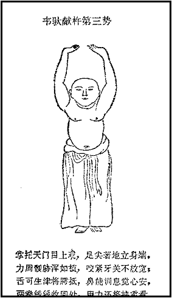

> **韦驮献杵第三势 · Vi Đà hiến xử đệ tam thế**
> 掌托天门目上观，足尖着地立身端，
> *Chưởng thác thiên môn mục thượng quan, túc tiêm trước địa lập thân đoan,*
> 力周腿胁浑如植，咬紧牙关不放宽；
> *Lực chu thối hiếp hồn như thực, giảo khẩn nha quan bất phóng khoan;*
> 舌可生津将腭抵，鼻能调息觉心安，
> *Thiệt khả sinh tân tương ngạc để, tỵ năng điều tức giác tâm an,*
> 两拳缓缓收回处，用力还将挟重看。
> *Lưỡng quyền hoãn hoãn thu hồi xứ, dụng lực hoàn tương hiệp trọng khan.*

# Thức thứ tư · Trích tinh hoán đẩu

## Trích tinh hoán đẩu (Với sao, đổi vị)

### 1.- Động tác, tư thế

(1), Chỉ thủ kích thiên (bàn tay chỉ trời): tiếp theo thức trên, chưởng phải di chuyển tới vị trí ngang lưng, úp bàn tay vào sống ngang lưng (huyệt Lao-cung áp vào huyệt Mệnh-môn). Đồng thời tay trái đưa lên cao, chưởng mở rộng hướng sang phải. Lưỡi từ từ nâng cao. Mắt nhìn vào tay. (H8). Thức này phải buông lỏng cần cổ, dẫn khí từ não (huyệt Bách-hội) theo xương sống (Đốc-mạch tới huyệt Mệnh-môn).

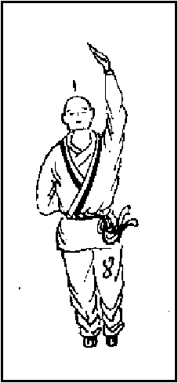

(2), Phủ chưởng quán khí (úp chưởng thu khí): tiếp thức trên, chưởng trái hơi hạ xuống, đầu cổ ngay. Đỉnh lưỡi từ từ hạ xuống. Hai mắt nhìn thẳng, hơi khép lại. (H9). Ý niệm khí từ lưng bàn tay trái thoát ra.

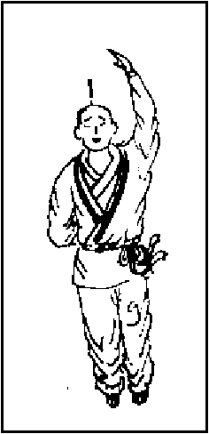

(3), Án chưởng tẩy tủy (giữ bàn tay, tẩy tủy): tiếp theo thức trên, tay trái từ từ hạ xuống ngực, bụng (H10). Ý niệm như trên.

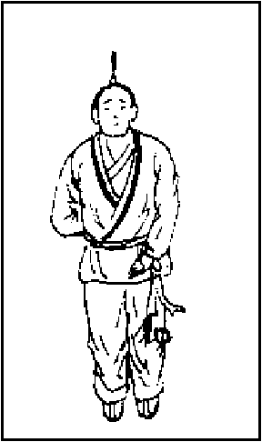

### 2.- Hiệu năng

Điều lý tỳ vị (điều hòa khí tỳ vị).

### 3.- Chủ trị

Trị tất cả các bệnh tỳ vị, ruột. Trị các bệnh vai, cổ, lưng.

### 4.- Nguyên bản

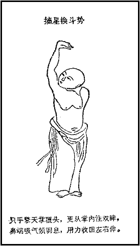

> **摘星换斗势 · Trích tinh hoán đẩu thế**
> 只手擎天掌覆头，更从掌内注双眸，
> *Chỉ thủ kình thiên chưởng phúc đầu, cánh tòng chưởng nội chú song mâu,*
> 鼻端吸气频调息，用力收回左右侔。
> *Tỵ đoan hấp khí tần điều tức, dụng lực thu hồi tả hữu mâu.*

# Thức thứ năm · Trắc sưu cửu ngưu vỹ

## Trắc sưu cửu ngưu vỹ (Nghiêng mình tìm đuôi trâu)

### 1.- Động tác, tư thế

(1), Cung bộ quan chưởng (bước khom, quay chưởng): đổi tư thức, hai bàn tay nắm nhẹ, đưa ra sau lưng, chưởng tâm hướng thượng. Chân trái bước về trước một bước, gối khom xuống hình cung, đồng thời tay trái đưa lên ngang với đầu đỉnh, chưởng tâm hướng nội. Trong thức này, mắt nhìn vào chưởng trái. Tay phải hơi đưa về sau. Hô hấp tự nhiên, lưỡi đưa lên trên. (H11).

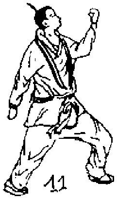

Đổi thức, phải, trái giống nhau, duy phương hướng khác biệt.

(2), Thanh hư tẩy tủy (buông lỏng tẩy tủy): vẫn tư thức trên, hai chưởng mở ra buông lỏng, đỉnh lưỡi hướng thượng, mắt khép nhẹ. Dùng ý dẫn khí từ bàn tay (huyệt Lao-cung) đưa khí vào thân, hàm, răng, nhập não (huyệt Bách-hội), rồi đưa theo xương sống (Đốc-mạch) xuống đùi, chân, bàn chân (huyệt Dũng-tuyền). (H12).

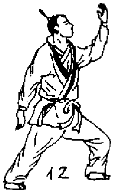

Đổi thức, phải, trái giống nhau, duy phương hướng khác biệt.

(3) Tiếp cốt tẩy tủy (thấm xương tẩy tủy), tiếp thức trên. Chân trái thu hồi, cùng chân phải song song. Hai tay cũng thu hồi, buông thõng bên hông, rồi từ từ đưa lên cao như phần (3) và (4) thức thứ ba.

### 2.- Hiệu năng

Cường kiên tứ chi, Ích tủy, trợ dương.

### 3.- Chủ trị

Tất cả các chứng đau nhức tứ chi, Đau ngang lưng, Dương ủy (Impuissances sexuelles), Di, mộng tinh. Nữ lãnh cảm, Tất cả các bệnh thời kỳ mãn kinh.

### 4.- Nguyên bản

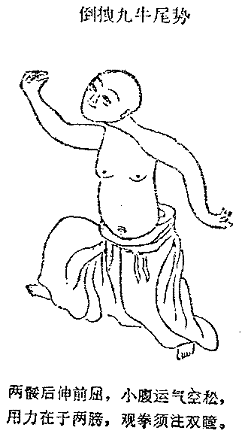

> **倒拽九牛尾势 · Đảo duệ cửu ngưu vĩ thế**
> 两腿后伸前屈，小腹运气空松，
> *Lưỡng thối hậu thân tiền khuất, tiểu phúc vận khí không tùng,*
> 用力在于两膀，观拳须注双瞳。
> *Dụng lực tại ư lưỡng bàng, quan quyền tu chú song đồng.*

# Thức thứ sáu · Xuất trảo lượng phiên

## Xuất trảo lượng phiên (Xuất móng khuất thân)

### 1.- Động tác, tư thế

(1), Quật quyền liệt yêu (móc quyền chuyển lưng): tiếp theo thức trên, gập người về trước 90 độ. Hai tay tự nhiên buông thõng. Mắt nhìn thẳng về trước. Sau đó từ quyền biến ra chưởng (bàn tay mở ra), rồi người từ từ thẳng dậy, hai cánh tay ép nhẹ vào thân, bàn tay hướng thượng. (H13). Khi người gập xuống thì Thổ. Lúc người thẳng dậy thì Nạp.

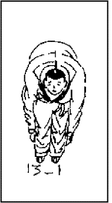

(3), Hấp khí hồi thu (hít khí, trở lại bình thường), tiếp thức trên, bàn tay buông lỏng, cùi chỏ gập, hai tay từ từ thu lại, đưa ngang lưng, Nạp khí. Nếu sức yếu, hoặc tuổi cao thì chỉ luyện một lần. Còn như thanh tráng niên muốn tăng cường thể lực có thể tiếp tục: hai tay đưa lên, chưởng tâm hướng thượng Thổ ra rồi hạ xuống Nạp vào. Luyện liền 7 lần.

### 2.- Hiệu năng

Bổ tinh ích thận, Dưỡng tâm kiên phế.

### 3.- Chủ trị

Trị tất cả các bệnh tâm, phế, thận mãn tính. Trị các bệnh cườm tay.

### 4.- Nguyên bản

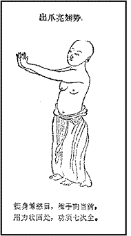

> **出爪亮翅势 · Xuất trảo lượng sí thế**
> 挺身兼怒目，推手向当前，
> *Đĩnh thân kiêm nộ mục, thôi thủ hướng đương tiền,*
> 用力收回处，功须七次全。
> *Dụng lực thu hồi xứ, công tu thất thứ toàn.*

# Thức thứ bảy · Bạt mã đao thế

## Bạt mã đao thế (Cỡi ngựa vung đao)

### 1.- Động tác, tư thế

(1), Định thân bối kiến (đứng vững, nhận lưng): trở lại tư thức dự bị lúc đầu. Tay phải đưa ra lưng, xương sống nơi ngang thắt lưng (huyệt Mệnh-môn), chưởng tâm quay về sau (tức lưng bàn tay áp vào xương sống). Đồng thời tay trái cử cao hơn đầu. Co cùi chỏ lại, tay úp vào gáy, ngón tay ép lên tai phải. Chưởng tâm hướng về trước. Sau khi đạt thức rồi, đầu đỉnh, sống lưng đồng thời nghiêng phải, mắt nhìn vào ngón chân. (H15). Đỉnh lưỡi đưa lên.

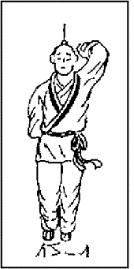

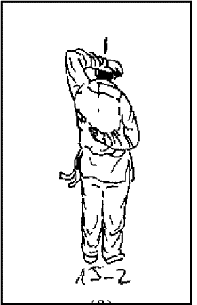

Đổi, phải trái cùng thức, duy phương hướng khác nhau.

(2), Đầu trắc thượng quan (đầu nghiêng, nhìn lên): tiếp thức trên. Thân trở về chính vị. Nghiêng đầu, nhìn lên, hai mắt hướng về phương xa. (H16).

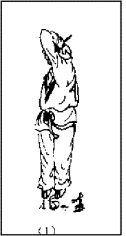

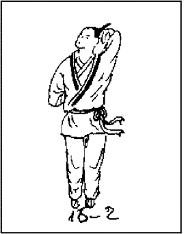

Đổi, phải trái cùng thức, duy hướng trái ngược nhau.

### 2.- Hiệu năng

Làm mạnh, làm chắc chắn lưng bụng, lồng ngực, cùng cổ.

### 3.- Chủ trị

Trị tất cả các bệnh bụng, lưng, ngực, cổ, Bàn tọa, ngang lưng.

### 4.- Nguyên bản

Hình cổ bị mờ, bỏ qua, vì không cần thiết. Tuy nhiên nguyên bản vẫn còn đủ:

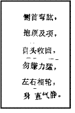

> **九鬼拔马刀势 · Cửu quỷ bạt mã đao thế**
> 侧首弯肱，抱顶及项，
> *Trắc thủ loan quăng, bão đỉnh cập hạng,*
> 自头收回，勿嫌力猛，
> *Tự đầu thu hồi, vật hiềm lực mãnh,*
> 左右相轮，身直气静。
> *Tả hữu tương luân, thân trực khí tĩnh.*

# Thức thứ tám · Tam thứ lạc địa

## Tam thứ lạc địa (Ba lần xuống đất)

### 1.- Động tác, tư thế

(1), Hạ án tẩy tủy (án phía dưới, tẩy tủy): tư thức như dự thức đầu. Hai tay từ từ cử lên trên, chưởng tâm hướng thượng tới đầu đỉnh. Hai chưởng tâm đối nhau, đồng thời ngước mắt nhìn trời. Hai mắt nhìn về phía vô tận của bầu trời. Lưỡi đưa lên cao. Sau đó đầu cổ thẳng, úp chưởng hướng trở xuống, rồi hạ tay xuống ngang bụng. (H17). Ý niệm “Chưởng thác thiên môn” như đệ tam thức.

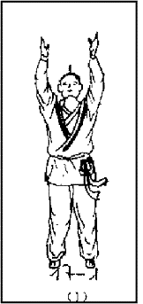

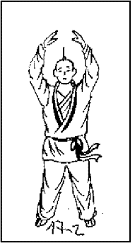

(2), Mã bộ tồn án (xoạc chân trên lưng ngựa): tiếp thức trên, gập gối như ngồi trên lưng ngựa, đồng thời hai tay phân hướng hai bên thân, các đầu ngón tay hướng ngoại. Đó là thức mã bộ, mắt nhìn về trước. Lồng ngực, lưng, đùi như mở ra thành thức thượng hư hạ thực. (H18).

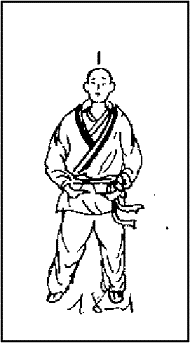

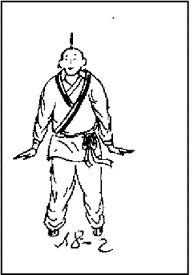

(3) Chưởng thác thiên cân (chưởng đẩy nghìn cân): tiếp theo thức trên. Hai chân đang xoạc, thu hẹp lại. Hấp khí. Đỉnh lưỡi hướng trời. Đồng thời hai chưởng hướng thượng như đẩy vào một vật nặng nghìn cân, khi tới ngang vai thì đưa hai tay thành vị trí với vai thành đường thẳng. Hô khí. Hai bàn tay hướng lên trời. Giữ nguyên tư thức, một thời gian. Kế tiếp hai tay hạ xuống, gối gập như ngồi trên yên ngựa. Hai tay ép sát người, bàn tay hướng ngoại. Hô khí. Luyện liền ba thức. (H19). Những người huyết áp cao, hay thấp khi luyện thức này phải rất khoan thai. Thanh tráng niên trái lại luyện với tốc độ nhanh.

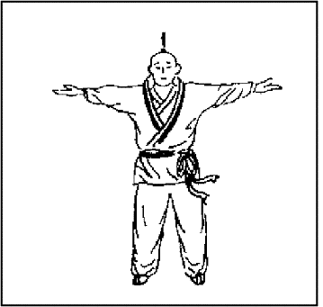

(4), Hạ án tẩy thủy (án dưới tẩy tủy): sau khi hoàn thành thức cuối, thì đứng thẳng dậy, hai tay từ từ đưa ngang đầu, chưởng tâm đối nhau, nghiêng đầu nhìn ra xa, đỉnh lưỡi nâng cao. Đầu cổ thẳng, hai tay hạ xuống ngang bụng như thức thứ 8 (H17).

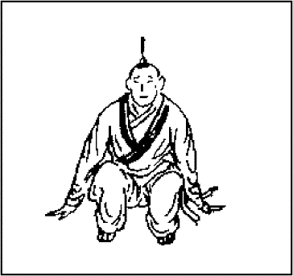

### 2.- Hiệu năng

Bồi bổ nguyên khí, Cường kiên cân lực (làm mạnh, làm gân chắc chắn).

### 3.- Chủ trị

Trị lưng đau, Dương ủy (bất lực sinh lý). Các bệnh về chân.

### 4.- Nguyên bản

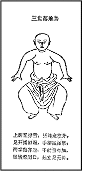

> **三盘落地势 · Tam bàn lạc địa thế**
> 上腭坚撑舌，张眸意注牙，
> *Thượng ngạc kiên xanh thiệt, trương mâu ý chú nha,*
> 足开蹲似踞，手按猛如拿，
> *Túc khai tồn tự cứ, thủ án mãnh như nã,*
> 两掌翻齐起，千斤重有加，
> *Lưỡng chưởng phiên tề khởi, thiên cân trọng hữu gia,*
> 瞪睛兼闭口，起立足无斜。
> *Trừng tình kiêm bế khẩu, khởi lập túc vô tà.*

# Thức thứ chín · Thanh long thám trảo

## Thanh-long thám trảo (Rồng xanh dương vuốt)

### 1.- Động tác, tư thế

(1), Khuất quyền liệt yêu (gập quyền, xuyên lưng): như thức thứ 6, Xuất trảo lượng phiên và Khuất quyền liệt yêu. (H13).

(2), Khuất thân thám chưởng (nhiêng mình xuất chưởng): quyền phải đưa ra sau lưng (huyệt Mệnh-môn). Quyền trái đưa lên khỏi đầu. Lưng, đầu từ từ nghiêng qua phải. Tay trái vòng qua đỉnh đầu nghiêng theo, tay phải tự nhiên bị vòng ra phía hông. Sau đó toàn thân chuyển sang phải, trong khi hai chân giữ nguyên vị trí. Mắt nhìn đầu bàn tay trái. (H20).

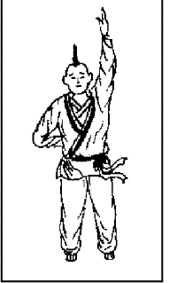

Đổi hướng phải trái giống nhau, duy phương hướng khác nhau.

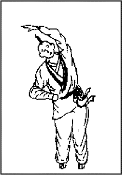

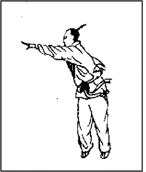

(3), Khuất thân quá mạch (hạ thân dưới gối): quyền phải áp vào giữa sống lưng, gập gối, xoạc chân. Chưởng tâm trái hướng thượng, lưng bàn tay cách mặt đất khoảng 10 cm, chuyển tay song song với mặt đất từ bên phải sang phía chân trái. Tay phải từ quyền biến thành chưởng đưa xuống thấp. Thân thể do nghiêng chuyển sang ngay, song chưởng đưa ra hai bên đùi. (H21).

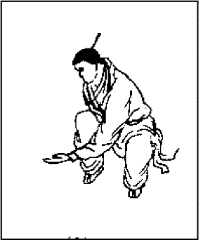

Đổi hướng phải, trái giống nhau, duy phương hướng khác nhau.

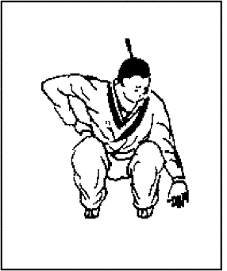

(4), Tiếp cốt tẩy thủy: giống như thức thứ 5.

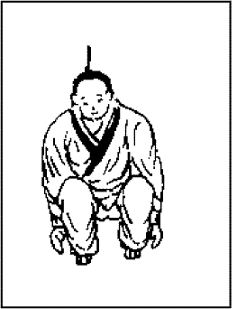

### 2.- Hiệu năng

Cường yêu kiên thận (làm mạnh lưng, kiên cố thận).

### 3.- Chủ trị

Trị tất cả các bệnh đau xương sống kinh niên. Trị các bệnh về thận: Yếu sinh lý, hay quên, răng lung lay.

### 4.- Nguyên bản

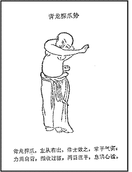

> **青龙探爪势 · Thanh long thám trảo thế**
> 青龙探爪，左从右出，修士效之，掌平气实；
> *Thanh long thám trảo, tả tòng hữu xuất, tu sĩ hiệu chi, chưởng bình khí thực;*
> 力周肩背，围收过膝，两目注平，息调心谧。
> *Lực chu kiên bối, vi thu quá tất, lưỡng mục chú bình, tức điều tâm mịch.*

# Thức thứ mười · Ngọa hổ phốc thực

## Ngoạ hổ phốc thực (Cọp đói vồ mồi)

### 1.- Động tác, tư thế

(1), Hổ cứ thâm sơn (hổ ngồi trong rừng sâu): khởi từ dự bị thức. Hơi cúi về trước, hai bàn tay khum khum thành quyền đưa về trước. Quyền tâm hướng thượng. Tới ngang với ngực, chưởng tâm hướng nội, gối hơi khum lại.

(2), Cung bộ tiền phó (khum người hướng trước): chân trái bước về trước một bước, khum lại, đồng thời hai tay đưa thẳng về trước, hai bàn tay như móng cọp. (H22-1-2). Hai mắt nhìn vào song chưởng, miệng gầm thành tiếng “Huồm” như cọp gầm.

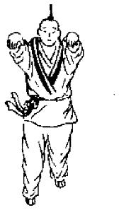

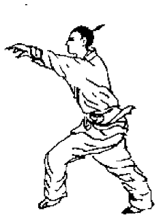

Kế tiếp, hai bàn tay án ở hai bên chân trái, lồng ngực xả khí, đầu ngước lên, mắt nhìn thẳng (H22-3).

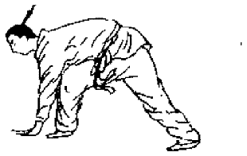

Hai chân bất động, đứng dậy, hai tay nắm thành quyền song song ngang hông (H22-4-5).

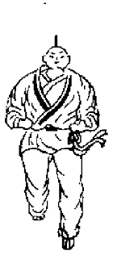

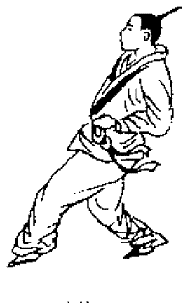

Đổi hướng, phải trái giống nhau, duy phương hướng khác nhau.

(3), Tiếp cốt tẩy tủy, xem thức thứ 5, phần Tiếp cốt tẩy tủy.

### 2.- Hiệu năng

Cường yêu tráng thận.

### 3.- Chủ trị

Trị thận hư bất túc.

### 4.- Nguyên bản

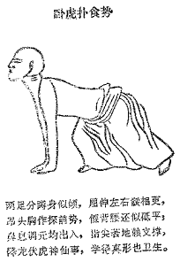

> **卧虎扑食势 · Ngọa hổ phốc thực thế**
> 两足分蹲身似倾，屈伸左右腿相更，
> *Lưỡng túc phân tồn thân tự khuynh, khuất thân tả hữu thối tương canh,*
> 昂头胸作探前势，偃背腰还似砥平；
> *Ngang đầu hung tác thám tiền thế, yển bối yêu hoàn tự để bình;*
> 鼻息调元均出入，指尖着地赖支撑，
> *Tỵ tức điều nguyên quân xuất nhập, chỉ tiêm trước địa lại chi xanh,*
> 降龙伏虎神仙事，学得真形也卫生。
> *Hàng long phục hổ thần tiên sự, học đắc chân hình dã vệ sinh.*

# Thức thứ mười một · Hoành chưởng kích cổ

## Hoành chưởng kích cổ (Vung tay đánh trống)

### 1.- Động tác, tư thế

(1), Thủ bão hậu não (tay ôm sau óc): khởi từ thế dự bị. Hai tay từ hai bên thân từ từ đưa lên qua đầu, ngước mặt nhìn trời. Kế tiếp gập cùi chỏ, hai tay tới mang tai, rồi vòng hai bàn tay án lên hai tai. (H23-1-2).

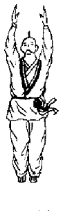

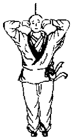

(2), Hoành chưởng kích cổ, Thân cúi dần về trước, đầu cúi tới gối, gối khum khum về trước. Các ngón tay nhè nhẹ ép vào sau gáy. Luyện liền 36 thức. (H24).

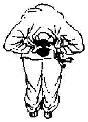

(3), Lưỡng biên yên tiếu (hai bên mỉm cười): từ từ ngay người lại. Vặn người sang phải, trái 7 lần, miệng nở nụ cười. Hai chân giữ nguyên vị thế. (H25-1-2).

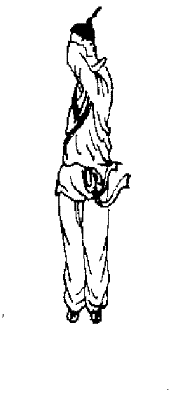

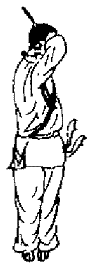

(4), Đề cước thượng thứ (dùng gót đâm lên): thức trên luyện xong, đứng thẳng người, hai chân chụm lại. Hai tay buông não ra, từ đưa thẳng lên cao. Chưởng tâm hướng lên trời. Hai đầu bàn tay chĩa vào nhau. Hấp khí. (H26).

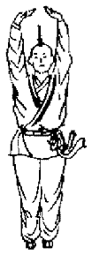

(5), Phủ chưởng quán khí. Xem thức thứ 3, Chưởng thác Thiên-môn và Phủ chưởng quán khí.

(6), Án chưởng tẩy tủy, xem thức thứ 3, Chưởng thác Thiên-môn và Án chưởng tẩy tủy.

### 2.- Hiệu năng

Tỉnh não, thông nhĩ, Xả bối cường yêu (Xả sống lưng, mạnh lưng).

### 3.- Chủ trị

Trị nhức đầu, tai điếc, tai kêu, đau vai, lưng đau.

### 4.- Nguyên bản

> **打躬势 · Đả cung thế**
> 两手齐持脑，垂腰至膝间，
> *Lưỡng thủ tề trì não, thùy yêu chí tất gian,*
> 头惟探胯下，口更齿牙关；
> *Đầu duy thám khóa hạ, khẩu cánh xỉ nha quan;*
> 掩耳聪教塞，调元气自闲，
> *Yểm nhĩ thông giáo tắc, điều nguyên khí tự nhàn,*
> 舌尖还抵腭，力在肘双弯。
> *Thiệt tiêm hoàn để ngạc, lực tại trửu song loan.*

# Thức thứ mười hai · Đề chủng hợp chưởng

## Đề chủng hợp chưởng (Đưa gót hợp chưởng)

### 1.- Động tác, tư thế

(1), Khởi từ thức dự bị, hai tay cạnh người, từ từ đưa lên cao, chưởng tâm hướng thượng, tới đầu đỉnh thì hai chưởng hợp nhau, chân giữ nguyên vị trí. (H27).

(2), Phủ ngưỡng điệu vỹ (Cúi, ngửa hợp với đuôi): Tiếp theo thức trên, hai chân khum xuống, hai tay hạ xuống ngực. (H28-1). Hai bàn tay úp vào nhau. Chưởng tâm hướng ngực. (H28-2).

Gối gập, lưng hạ xuống, hai bàn tay mở ra, chấm xuống đất ở hai mắt cá ngoài. (H28-3).

Sau đó thẳng lưng, hai tay đưa qua đầu, bàn tay đưa lên, chưởng tâm hướng trời, mười đầu ngón tay đối nhau. (H28-4). Luyện liền 3-5 thức.

(3), Tả hữu phủ ngưỡng (phải, trái cúi, ngửa): tiếp theo thức trên. Chân bất động. Lưng chuyển sang trái. Chân trái hư (không dùng sức nặng thân), chân phải thực (chuyển sức nặng thân lên chân phải). Hai tay giữ nguyên đầu ngón tay đối nhau. Mặt đối nhìn vào chân trái. (H29-1).

Chân giữ nguyên vị trí. Thân thẳng dậy, song chưởng cử quá đầu. Chưởng tâm triều thượng. Đầu các ngón tay đối nhau. (H29-2).

Lưng quay 180 độ. (H29-3). Giữ nguyên vị trí.

Cung thân, từ từ cúi xuống 90 độ, hai tay rời nhau, bàn tay xòe đối diện với mặt đất. (H29-4).

Luyện liền (1) (2) (3) 3-5 thức.

(4), Tiếp theo thức trên, hồi thân trở lại chính hướng. Hai tay từ từ hợp lại trước ngực, mười ngón tay đối nhau, chưởng tâm hướng hạ. Khi hai chưởng xuống ngang rốn, thì rời nhau, trở về vị trí như dự bị thức.

(5), Thức kết thúc: Buông lỏng hoàn toàn cơ thể. Hoặc nghỉ, uống một ly nước trái cây (dành cho việc trị bệnh). Hoặc vận khí một vòng Tiểu Chu-thiên, hoặc Thu công (dành cho các thầy thuốc châm cứu, các thầy thuốc đấm bóp, võ sư, võ sinh).

### 2.- Hiệu năng

Cường cân tráng cốt (mạnh gân, xương). Bổ thận, thêm tủy. Điều khí hoạt huyết.

### 3.- Chủ trị

Trị các bệnh về xương sống. Làm lưu thông máu, Làm khí điều hòa.

### 4.- Nguyên bản

> **掉尾势 · Điệu vĩ thế**
> 膝直膀伸，推手自地，瞪目昂头，凝神壹志，
> *Tất trực bàng thân, thôi thủ tự địa, trừng mục ngang đầu, ngưng thần nhất chí,*
> 起而顿足，二十一次，左右伸肱，以七为志，
> *Khởi nhi đốn túc, nhị thập nhất thứ, tả hữu thân quăng, dĩ thất vi chí,*
> 更作坐功，盘膝垂眦，口注于心，息调于鼻，
> *Cánh tác tọa công, bàn tất thùy tý, khẩu chú ư tâm, tức điều ư tỵ,*
> 定静乃起，厥功维备，总考其法，图成十二，
> *Định tĩnh nãi khởi, quyết công duy bị, tổng khảo kỳ pháp, đồ thành thập nhị,*
> 谁实贻诸，五代之季，达摩西来，传少林寺，
> *Thùy thực di chư, Ngũ Đại chi quý, Đạt Ma tây lai, truyền Thiếu Lâm tự,*
> 有宋岳侯，更为鉴识，却病延年，功无与类。
> *Hữu Tống Nhạc hầu, cánh vi giám thức, khước bệnh diên niên, công vô dữ loại.*

# Tổng kết

Thưa Quý Đồng-nghiệp,

Quý vị vừa nghe chúng tôi trình bày phương pháp luyện Dịch Cân kinh. Sau đây tôi xin có đôi lời cuối cùng:

1.- Khi Quý-vị đem giảng cho thân chủ, chắc chắn Quý-vị sẽ gặp những người từng luyện bản Dịch Cân Tẩy Tủy kinh này. Tuy nhiên những động tác có khác. Lý do, có thể họ học ở các Võ-sư, mà bản chất của các Võ-sư là luyện lực. Quý vị cần phân tích cho họ biết cái khác nhau. Cũng có thể Quý-vị sẽ gặp những người luyện phải bản bịa đặt.

2.- Những động tác mà chúng tôi trình bày trong bài này, chỉ có tính cách tượng trưng, không nhất thuyết phải giữ vị trí này hay vị trí nọ.

3.- Khi mới luyện thì mỗi ngày chỉ luyện một lần, mỗi lần một thức. Sau khi đã quen rồi, thì cũng mỗi ngày một lần, mỗi lần nhiều thức.

4.- Cổ nhân nói: Văn ôn, võ luyện, quý dĩ chuyên. Nghĩa là học văn thì phải ôn nhiều lần; luyện võ thì cần chuyên. Muốn có kết quả thì ngày nào cũng phải luyện.

5.- Một yếu tố quan trọng, là sau khi luyện phải thu công. Không thu công thì khí sẽ chạy hỗn loạn.

Cảm ơn Quý-vị đã chú ý theo dõi. Cảm ơn nữ Bác-sĩ Trần Huỳnh Huệ, giám đốc Espace Qi Gong đã biểu diễn mẫu.

Trân trọng kính chào Quý-vị.

*Trần Đại-Sỹ*

# Phụ lục · Đạt Ma Dịch Cân Kinh

Thưa Quý đồng nghiệp,

Dưới đây là phần phụ lục về bản Dịch Cân kinh mới được sáng tạo trong nội địa Việt-Nam, do người Việt truyền tụng, nhưng cũng gán cho tác giả là Bồ-đề Đạt-ma (mà tôi đã nói ở phần đầu). Xuất phát tập tài liệu này từ Lương-y Phạm Văn Bình trao cho ông Phạm Viết Hồng Lam, giảng viên Hội-họa trường Cao-đẳng Sư-phạm Nhạc-họa (Hà-nội? Sài-gòn?). Ông Lam luyện từ ngày 7-2-89 đến tháng 5-89 thì khỏi chứng Ung-thư họng thời kỳ thứ nhì!!! Sau đó ông Lam cho đăng trên báo Hà Nội Mới (không rõ số ra ngày nào?). Sau liệu này truyền sang Hoa-kỳ, đăng trên báo Người Việt USA số 17-11-2000, và nhà văn Vũ Hạnh sưu tầm được!!!

Biết chắc trăm phần trăm là ngụy tạo, một loại ngụy tạo nhà quê, để che dấu hình thức quảng cáo rẻ tiền. Tuy nhiên vì trong tài liệu còn có sự chứng nhận của đồng nghiệp Lê Quốc Khánh (?) khiến chúng ta không thể phủ nhận hoàn toàn. Mong Quý Đồng-nghiệp nghiên cứu, và thông báo cho tôi biết kết quả. Tôi cũng nhắc ở đây là trong những Bác-sĩ tốt nghiệp thời Pháp, cũng như thời Việt-Nam Cộng-hòa, không có Bác-sĩ nào tên Lê Quốc Khánh cả. Chỉ có một Bác-sĩ Lê Quốc Hanh ra trường năm 1960, quá trẻ so với Bác-sĩ Khánh trong bài này.

## Đạt Ma Dịch Cân Kinh

*(Của nhà văn Vũ Hạnh sưu tầm và nhờ Bác sĩ Lê Quốc Khánh lên mạng lưới Internet phổ biến trong thân hữu)*

**BS Lê Quốc Khánh**

Lời thưa: Sau khi đọc lần đầu, tập tài liệu Đạt Ma Dịch Cân Kinh tôi chỉ biết mỉm cười, không mấy tin tưởng vì thấy phương pháp chữa trị những bệnh nan y một cách dễ dàng, đơn giản.

Tôi cũng xin tự giới thiệu để quý vị thấy rằng tôi đã được đào tạo và phục vụ Tây y qua nhiều thời kỳ, đến nay tôi đã có bốn mươi chín năm y nghiệp, đã từng làm việc trong các bệnh viện Quân và Dân y lớn nhất nhì, đã làm việc với những người Pháp, Mỹ, Phi Luật Tân; đã từng là cộng tác viên của bác sĩ Đinh Văn Tùng, nghiên cứu chữa trị bệnh ung thư qua phẫu thuật (1936-1965). (1) Tôi muốn nói rằng tôi có lý do để tin tưởng Tây y là một ngành khoa học có nhiều thành tích đáng tin cậy trong việc bảo vệ sức khoẻ con người. Cũng vì vậy mà tôi gần như có thái độ thờ ơ khi tiếp nhận tập Đạt Ma Dịch Cân Kinh.

Thế rồi một hôm, có người bạn cùng tuổi với tôi (2) (sinh năm 1932) đi xe đạp ghé thăm, tôi được nghe anh kể là anh đã khám bệnh ở bệnh viện Chợ Rẫy, qua các xét nghiệm y khoa tối tân và các bác sỹ đã định bệnh cho anh:

- Ung thư gan,
- Lao thận.

Anh thấy hoàn toàn thất vọng, vì nếu vấp phải một trong hai bệnh ấy cũng đủ chết rồi, huống chi mắc cả hai chứng bệnh nan y cùng một lúc. Cuối cùng, anh có được tập tài liệu Đạt Ma Dịch Cân Kinh, cái phao mà anh níu được khi đang chơi vơi giữa biển khơi. Anh cố gắng tập, kiên trì thực hiện đúng theo tài liệu, và kết quả là anh đã thắng bệnh tật. Hiện nay, anh sống khoẻ mạnh bình thường, làm nghề hớt tóc, có khi anh phải đứng hàng giờ để làm công việc, thế mà anh vẫn bình thường như bao người khác. Từ đó đến nay đã bốn năm, anh vẫn tập đều đặn. Nhìn tư thế và sắc diện, không ai nghĩ là anh đã mắc bệnh nan y. Thỉnh thoảng anh vẫn đi xe đạp đến thăm tôi. Cũng từ đó, tôi chú tâm nghiên cứu Dịch Cân Kinh.

Đầu năm 1996, tôi đã truyền đạt tài liệu này cho một người bạn trẻ (sinh năm 1932) bị bệnh lao phổi, không được điều trị đúng cách vì hoàn cảnh bản thân cũng như xã hội vào thập niên 80, cuối cùng anh đã gầy guộc chỉ còn ba mươi hai kg trong cơ thể suy nhược, đã mấy lần cứ tưởng là không qua khỏi, và anh đã vớt vát chút hy vọng còn lại, anh đã tập Yoga. Kết quả cơ thể cơ phần nào phục hồi nhưng vẫn yếu đuối. Suốt mùa Đông anh vẫn không ra khỏi nhà, nhìn sắc diện vẫn lộ những nét bệnh hoạn. Sau khi nhận được tập tài liệu Dịch Cân Kinh, anh đã cố gắng kiên trì luyện tập, thời gian đầu có những phản ứng như đã ghi trong tài liệu. Dần dần anh qua được bước đầu vất vả và gần cuối năm 1996, sau bốn tháng luyện tập, anh đã ho tống ra một khối huyết cứng to bằng trứng chim cút và sau đó anh từ từ hồi phục sức khoẻ, da dẻ hồng hào, vẻ mặt vui tươi và mãi đến nay anh vẫn giữ được sắc thái như người bình thường không bệnh hoạn.

*(Tài liệu gốc dừng ở đây.)*
